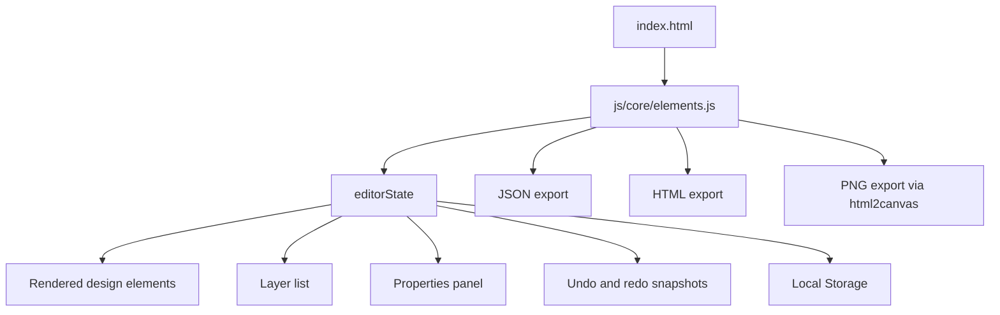

<div align="center">

  <a href="https://vishwakarmasanket.github.io/Enigma-Design-Tool/">
    
  </a>

  <h1>E N I G M A</h1>
  <p><strong>The lightweight design tool crafted precisely with Vanilla JavaScript.</strong></p>
  <p>Zero Dependencies. 100% Performance. Now with V2 Powers.</p>

  <p>
    <a href="https://vishwakarmasanket.github.io/Enigma-Design-Tool/">
      
    </a>
  </p>

  <p>
    
    
    
    
  </p>
</div>

---

## About Enigma

Enigma is a lightweight, browser-based design editor built with native HTML, CSS, and JavaScript. It provides a familiar design-tool layout: a central artboard, a layer list, a properties inspector, and a floating toolbar for creating basic design elements.

The editor renders elements as regular DOM nodes instead of drawing everything into a bitmap canvas. A central in-memory document model, `editorState`, tracks element properties, the current selection, history snapshots, and an in-app clipboard.

**Live demo:** [Launch Enigma](https://vishwakarmasanket.github.io/Enigma-Design-Tool/)

For the full source walkthrough—including initialization, element schema, event flows, persistence, export behavior, and known edge cases—see the [Technical Reference](docs/TECHNICAL_REFERENCE.md).

## Contents

- [Features](#features)
- [Interface overview](#interface-overview)
- [Getting started](#getting-started)
- [Editing workflow](#editing-workflow)
- [Keyboard shortcuts](#keyboard-shortcuts)
- [Exporting designs](#exporting-designs)
- [How it works](#how-it-works)
- [Project structure](#project-structure)
- [Customization](#customization)
- [Dependencies and browser requirements](#dependencies-and-browser-requirements)
- [Current limitations](#current-limitations)
- [Roadmap](#roadmap)
- [Documentation](#documentation)

## Features

### Design elements

- **Rectangle** — creates a 100 × 100px blue shape.
- **Ellipse** — creates a 100 × 100px pink shape.
- **Line** — creates a 150 × 5px dark strip. In the current implementation, this is a thin rectangle rather than a vector path.
- **Text** — creates a text box with the default content “Double click”; double-click the element to edit its text.

New elements are placed at x=100px and y=100px by default. Use dragging, resize handles, and the properties panel to refine their layout.

### Direct manipulation

- Click an element to select it.
- Drag an element to change its position.
- Use its four corner handles to resize it.
- Change position, dimensions, rotation, fill, opacity, border, shadow, and (for text) font properties from the right-hand inspector.
- Use the left-hand Layers panel to select an element and move it forward or backward in the stacking order.

### Productivity

- Undo and redo history.
- Copy and paste a single selected element within the editor.
- Nudge the selected element using the arrow keys.
- Automatically persist the element list in browser Local Storage.
- Export the current design to JSON, HTML, or PNG.

> **Implementation note:** these features are implemented in the current source, but there are known edge cases in history retention and HTML export. Read [Current limitations](#current-limitations) before depending on those workflows.

## Interface overview

| Area | Responsibility |
|---|---|
| **Left sidebar — Layers** | Lists design elements in stacking order. Select a row to select its element; use the arrows to change the order. |
| **Center — Artboard** | Fixed 800 × 500px white design surface over a dotted workspace. |
| **Bottom toolbar** | Adds a rectangle, ellipse, line strip, or text box. |
| **Right sidebar — Properties** | Edits transform, typography, fill, opacity, border, and shadow values for the selected element. |
| **Floating header** | Displays Enigma branding and the current version label. |

The canvas currently uses fixed logical dimensions. Infinite panning, zooming, multi-select, and grouping are not implemented.

## Getting started

Enigma is a static site. There is no npm install step or application build pipeline in this repository. Because the entry point loads a JavaScript ES module, use a local HTTP server for the most consistent results.

### Option 1: Clone and run with Python

1. Clone the repository:

   ```bash
   git clone https://github.com/VishwakarmaSanket/Enigma-Design-Tool.git
   cd Enigma-Design-Tool
   ```

2. Start a static server from the repository root:

   ```bash
   python -m http.server 8000
   ```

3. Open [http://localhost:8000](http://localhost:8000).

### Option 2: VS Code Live Server

Clone or download the repository, open the folder in VS Code, and start **Live Server** from the root index.html.

### No build command

There is currently no package.json, npm script, bundler configuration, or test command. The live HTML loads the committed stylesheet and JavaScript module directly.

## Editing workflow

1. **Add an object.** Select Rectangle, Ellipse, Line, or Text from the toolbar. The object appears at its default location and is selected.
2. **Move it.** Drag the object on the artboard. Position is constrained by the canvas during dragging.
3. **Resize it.** Drag one of the four corner handles.
4. **Style it.** Use the Properties panel. Text elements expose additional typography controls.
5. **Arrange it.** In Layers, select an element or use the up/down controls to change stacking order.
6. **Undo or redo.** Use the shortcuts below. The Undo button is also available in the Properties panel.
7. **Continue later.** The element array is saved under the browser Local Storage key enigma_v2_data and is reloaded when the app initializes in the same browser origin.
8. **Export.** Use Export JSON, Export HTML, or Export PNG in the Actions section of the Properties panel.

Local Storage is scoped to the site's origin and browser profile. Work saved on the deployed site does not automatically appear on localhost, and vice versa.

## Keyboard shortcuts

The table below reflects the handlers currently registered in js/core/elements.js.

| Shortcut | Action |
|---|---|
| Ctrl/Cmd + Z | Undo |
| Ctrl/Cmd + Y | Redo |
| Ctrl/Cmd + C | Copy the selected element to Enigma's in-app clipboard |
| Ctrl/Cmd + V | Paste a duplicate, offset by 20px |
| Delete / Backspace | Delete the selected element |
| Arrow keys | Move the selected element by 5px |
| Shift + Arrow | Move the selected element by 10px |
| Double-click a text element | Enter text-editing mode |

Keyboard shortcuts are skipped while typing in an input, textarea, or content-editable element. Copy/paste is internal to Enigma; it does not read or write the operating system clipboard.

**Escape is not currently wired to deselect.** Although it appears in an older feature list, there is no Escape-key handler in the active source.

## Exporting designs

Exports are generated in the browser from the current in-memory element array or current DOM. They are not sent to a server.

| Format | Download name | What it contains |
|---|---|---|
| JSON | enigma-design.json | Formatted array of element objects, including geometry and style properties |
| HTML | design.html | Standalone HTML containing absolutely positioned design elements and inline styles |
| PNG | design.png | Raster image captured from the artboard through html2canvas |

### Export details

- **JSON** is the most direct representation of the current internal model. The current interface does not include a JSON import control.
- **HTML** creates a compact standalone layout; it does not reproduce the editor UI or use the complete application stylesheet.
- **PNG** uses the html2canvas library loaded from cdnjs. If the library is unavailable, the app shows an alert.

See the [Technical Reference — Export formats](docs/TECHNICAL_REFERENCE.md#9-export-formats) for implementation details and known defects.

## How it works

### Application startup

The browser loads index.html, the compiled stylesheet at styles/main.css, a Google Fonts stylesheet, the html2canvas CDN script, and js/core/elements.js as an ES module. The engine initializes its state and listeners, restores saved elements from Local Storage, renders those elements, populates Layers, and records an initial history snapshot.

### State and rendering

The editorState.elements array is the in-memory document. Each item has a UUID, type, x/y coordinates, width/height, and style properties. The engine creates one outer DOM wrapper and one content element for each object, then applies styles to represent geometry, fill, opacity, border, shadow, and text formatting.

When users manipulate an element, the engine mutates its object in the array and updates the related DOM. History snapshots serialize the element array as JSON. saveHistory() also writes the current element list to Local Storage.



For deeper details about state ownership, object creation, selection, event handlers, layer order, persistence, and export implementation, read the [Technical Reference](docs/TECHNICAL_REFERENCE.md).

## Project structure

```text
Enigma-Design-Tool/
├── index.html
├── debug.html
├── favicon.svg
├── favicon.png
├── fonts/
│   └── Inter_24pt-Regular.ttf
├── js/
│   ├── core/
│   │   └── elements.js
│   └── ui/
│       └── propertiesPanel.js
├── styles/
│   ├── base/
│   │   ├── _mixins.scss
│   │   ├── _reset.scss
│   │   └── _variables.scss
│   ├── components/
│   │   ├── _layers-panel.scss
│   │   └── _properties-panel.scss
│   ├── layout/
│   │   ├── _app.scss
│   │   ├── _canvas.scss
│   │   ├── _sidebar.scss
│   │   └── _toolbar.scss
│   ├── main.css
│   ├── main.css.map
│   └── main.scss
├── css/
│   ├── main.css
│   └── main.css.map
├── docs/
│   └── TECHNICAL_REFERENCE.md
└── README.md
```

The runtime entry is index.html, which loads styles/main.css and js/core/elements.js. The alternate css/main.css and the separate js/ui/propertiesPanel.js are not imported by the active page.

## Customization

### Change the visual theme

Edit the custom properties near the bottom of styles/main.scss, including:

| Variable | Purpose |
|---|---|
| --bg-app | Workspace background |
| --bg-panel | Sidebar and toolbar background |
| --bg-canvas | Artboard color |
| --text-main / --text-muted | Panel typography colors |
| --border-color | Dividers and panel borders |
| --primary / --primary-hover | Accent and hover colors |
| --active-item-bg | Selected-layer background |

The page loads styles/main.css, not SCSS. There is no Sass build script included, so CSS must be regenerated or updated when source SCSS changes.

### Change object defaults and logic

The createElement(type) function in js/core/elements.js defines initial dimensions and fill colors. updateElementVisuals() controls how stored properties are applied to each DOM element. The property inspector's controls and their data-prop names are defined in index.html.

### Change the artboard size

The artboard dimensions are defined in styles/layout/_canvas.scss. Several movement/paste limits in js/core/elements.js are hard-coded to 800 × 500, so coordinate and keyboard behavior must be updated consistently if you change the canvas dimensions.

## Dependencies and browser requirements

Enigma has no npm dependencies or build pipeline, but it does use a few browser APIs and external resources:

- **html2canvas 1.4.1** from cdnjs is required for PNG export.
- **Google Fonts** provides Inter, Roboto, Playfair Display, and Montserrat. A local Inter font file is also in the repository.
- **Local Storage** stores the element list in the browser.
- **Blob and object URL APIs** create local download files.
- **crypto.randomUUID()** creates unique element IDs.
- **JavaScript ES modules** are used by the runtime entry point.

For offline use, the externally loaded font stylesheet and html2canvas script may be unavailable. Core element creation and editing do not require a server API; they run in the browser once the page assets have loaded.

## Current limitations

These are observations from the current source, not claims about a production incident:

- **HTML export with text:** exportToHTML() refers to element.textAlign although the loop variable is el. Exporting a document that contains a text element can throw before the download is created.
- **HTML escaping:** text content is inserted into the generated HTML without escaping.
- **History limit:** history retention shifts the oldest snapshot without adjusting the history cursor; long editing sessions may expose cursor inconsistencies.
- **Property-panel bounds:** geometry entered through numeric controls is not clamped the same way as drag/resize operations.
- **Layer reorder and handles:** reordering rebuilds element DOM; the selected wrapper may lose resize handles until selection changes.
- **Storage error recovery:** malformed Local Storage JSON and storage read/write errors are not caught, and no in-app reset/recovery action is provided.
- **Selection after PNG export:** PNG export clears the current selection to hide handles and does not restore it after capture.
- **Mouse-centric input:** dragging and resizing use mouse events; explicit touch/pointer-event and keyboard focus behavior is limited.
- **Fixed canvas dimensions:** keyboard movement and paste bounds assume 800 × 500px.
- **No import action:** JSON export exists, but the UI does not currently provide a design-file import control.

## Roadmap

The repository's stated future ideas include:

- [ ] Infinite canvas with pan and zoom
- [ ] Multi-select and marquee selection
- [ ] Grouping elements into a single group container

These are roadmap ideas, not implemented features in the current source.

## Documentation

- **[Technical Reference](docs/TECHNICAL_REFERENCE.md)** — detailed architecture, code paths, state schema, editing flows, persistence, history, export formats, configuration, and known limitations.
- **[Source entry point](index.html)** — app markup and control definitions.
- **[Core engine](js/core/elements.js)** — current editor logic and interaction handlers.
- **[SCSS entry point](styles/main.scss)** — theme and style imports.

---

<div align="center">
  Designed & Engineered by Sanket Vishwakarma.
</div>

```
