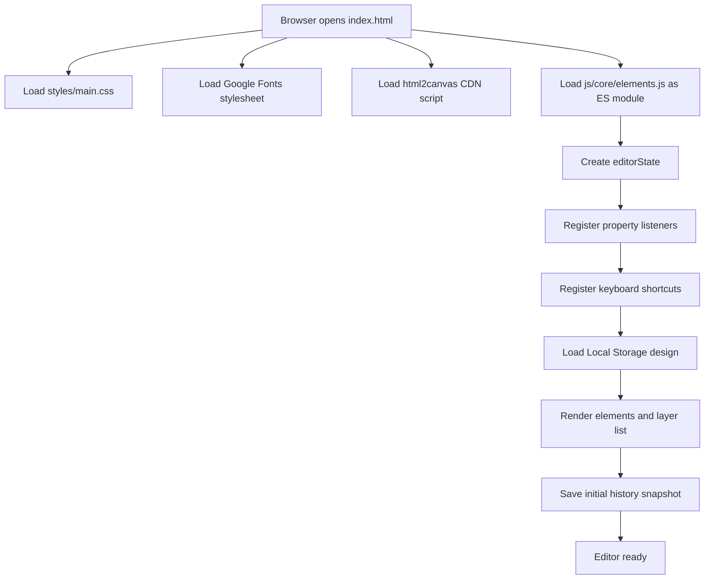
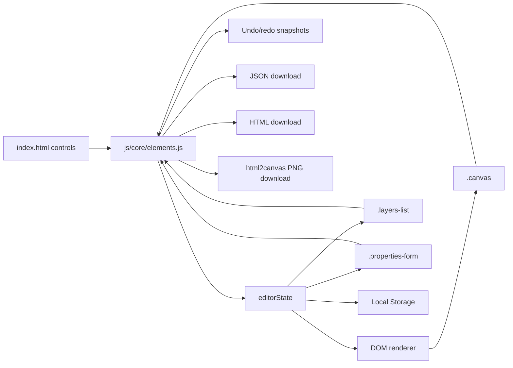

# Enigma Design Tool — Technical Reference

This document describes the implementation present in the repository's `main` branch. It is intended for developers who need to understand the editor's architecture, element lifecycle, interaction model, persistence, history, exports, configuration, and known implementation gaps.

## 1. Scope and implementation summary

Enigma is a client-side, DOM-rendered design editor built with native browser technologies: HTML, CSS/SCSS, and JavaScript ES modules. The editor presents a fixed-size 800 × 500 design surface, a left layer list, a bottom shape toolbar, and a right property inspector.

It is **not** a server-backed application. The repository contains no application API routes, backend process, database, authentication layer, server-side file handling, cloud synchronization, or collaborative editing. The editor stores the element list in browser Local Storage and creates downloads locally in the browser.

### Active page boot sequence



The order above follows the final initialization calls in `js/core/elements.js`. Some substeps occur conditionally: if Local Storage has no saved value, the load step does not render stored elements.

## 2. Repository map

| Path | Status | Responsibility |
|---|---|---|
| `index.html` | Active entry | Editor markup, left/right sidebars, canvas, shape toolbar, property controls, external resource links, and module script |
| `js/core/elements.js` | Active engine | State, object rendering, selection, drag/resize, keyboard shortcuts, history, Local Storage, layer ordering, and exports |
| `styles/main.css` | Active stylesheet | CSS loaded by `index.html` |
| `styles/main.scss` | Source stylesheet | Sass entry that imports layout and component partials and declares theme tokens |
| `styles/layout/_app.scss` | Active SCSS source | Global sizing, font-face, body overflow, app flex layout |
| `styles/layout/_sidebar.scss` | Active SCSS source | Sidebars and layer list layout |
| `styles/layout/_canvas.scss` | Active SCSS source | Canvas and floating app header styling |
| `styles/layout/_toolbar.scss` | Active SCSS source | Shape toolbar and hover tooltips |
| `styles/components/_layers-panel.scss` | Active SCSS source | Layer list appearance and item states |
| `styles/components/_properties-panel.scss` | Active SCSS source | Property inspector fields, buttons, and scrolling |
| `styles/base/_mixins.scss` | Empty file | No mixins currently defined |
| `styles/base/_reset.scss` | Empty file | No reset rules currently defined |
| `styles/base/_variables.scss` | Empty file | No variables currently defined here; theme tokens are in `styles/main.scss` |
| `js/ui/propertiesPanel.js` | Not loaded by current app | Separate/older property-panel implementation; imports `../state.js`, which is absent from this repository |
| `css/main.css` | Not loaded by `index.html` | Duplicate/alternate compiled stylesheet; active page instead loads `styles/main.css` |
| `css/main.css.map`, `styles/main.css.map` | Build artifacts | CSS source maps |
| `fonts/Inter_24pt-Regular.ttf` | Static asset | Local Inter font used by a stylesheet font-face rule |
| `favicon.svg`, `favicon.png` | Static assets | Branding/favicon |
| `debug.html` | Standalone auxiliary page | Contains a simple SVG mark; not imported by the editor |
| `README.md` | Project documentation | Project overview and usage |

There is no package manifest, application bundler config, npm script, unit-test suite, or server entry point in the repository tree inspected for this reference.

## 3. Architecture

### 3.1 Runtime modules

The active page declares its markup in `index.html`. The only application script it loads is `js/core/elements.js`, with `type="module"`. The engine currently contains most functionality in a single file and directly queries/mutates DOM nodes.

The engine uses these main state fields:

| Field | Type | Purpose |
|---|---|---|
| `editorState.elements` | Array of element objects | Authoritative in-memory design document and stacking order |
| `editorState.selectedElementId` | UUID string or `null` | ID of the currently selected element |
| `editorState.history` | Array of serialized element arrays | Undo/redo snapshots |
| `editorState.historyStep` | Number | Current history cursor |
| `editorState.clipboard` | Element object or `null` | One in-app copied element for keyboard copy/paste |

Pointer-interaction state is held separately in module variables:

| Variable | Purpose |
|---|---|
| `isDragging` | Whether the document-level mouse handler should move the selected element |
| `isResizing` | Whether a resize-handle gesture is active |
| `dragOffsetX` / `dragOffsetY` | Pointer offset from the element's bounding rectangle when dragging begins |
| `activeDOMElement` | DOM wrapper currently being dragged |

The helper `getEl(selector)` is a thin wrapper around `document.querySelector`. `generateID()` uses `crypto.randomUUID()` to create element IDs.

### 3.2 Rendering model

Elements are ordinary DOM nodes, not primitives drawn into an HTML `canvas` element. The visual drawing surface is a `div.canvas`.

Each design item renders to this hierarchy:

```html
<div class="element-wrapper" data-id="UUID">
  <div class="element-content">...</div>
  <!-- resize handles are appended to the wrapper while selected -->
</div>
```

- The outer wrapper receives position, dimensions, rotation, and z-index.
- The inner content receives fill, opacity, border, shadow, and text-specific styles.
- Selecting an item adds the `selected` class and appends four corner resize handles.
- CSS styles selected wrappers with an outline and styles the handles.
- The outer wrapper's z-index is derived from its index in `editorState.elements`.

The `updateElementVisuals(containerDiv, element)` function synchronizes the DOM appearance from the in-memory object. `renderElement(element)` creates the wrapper/content DOM and registers pointer/text-edit listeners.

### 3.3 Component and interaction diagram



There is no network request for normal object creation, movement, resizing, styling, selection, layer ordering, undo, or redo. PNG export rasterizes the current DOM using the externally loaded html2canvas library.

## 4. The canvas and coordinate system

The active CSS defines the canvas as:

| Property | Value |
|---|---|
| Width | 800 CSS pixels |
| Height | 500 CSS pixels |
| Background | White, from `--bg-canvas` |
| Position | Relative; design items are absolute-positioned |
| Overflow | Visible, allowing the selection handles to extend beyond item edges |

The surrounding `.canvas-wrapper` fills the available central column and centers the canvas over a dotted grid. The left and right sidebars are each styled to 240px wide; the layout does not implement infinite panning or zooming.

Coordinates `x` and `y` are the wrapper's left/top offsets relative to the design surface in pixels. Width and height are stored in pixels. Rotation is applied through CSS `transform: rotate(...)`.

### Bounds behavior

- Dragging clamps the new position to the rendered canvas bounds using its bounding rectangle and element dimensions.
- Resizing uses the canvas bounding rectangle and attempts to keep the result inside it. The minimum dimensions in resize logic are width 20px and height 5px.
- Arrow-key movement clamps to hard-coded bounds of 800 × 500 and moves 5px, or 10px with Shift.
- The active property-panel listener in `elements.js` directly assigns geometry values from number inputs; it does **not** apply the same clamping used by dragging and resizing. A user can therefore enter values that place or size an element outside the intended canvas.
- The code does not implement a responsive logical coordinate system. If the canvas dimensions are changed, the hard-coded keyboard and paste bounds need to be reviewed.

## 5. Element data model

All newly created elements use the same object shape. Some fields are meaningful primarily for text items, but the constructor populates them for all types.

### 5.1 Schema

| Property | Type | Creation default | Purpose |
|---|---|---|---|
| `id` | String (UUID) | `crypto.randomUUID()` | Stable element identity |
| `type` | String enum | Selected toolbar type | `rectangle`, `ellipse`, `line`, or `text` |
| `x` | Number | 100 | Left position in pixels |
| `y` | Number | 100 | Top position in pixels |
| `width` | Number | Type-dependent | Width in pixels |
| `height` | Number | Type-dependent | Height in pixels |
| `backgroundColor` | String | Type-dependent hex color or `transparent` | Fill color |
| `rotate` | Number | 0 | Rotation in degrees |
| `opacity` | Number | 1 | Content opacity, nominally 0–1 via the range control |
| `borderWidth` | Number | 0 | Border width in pixels |
| `borderColor` | String | `#000000` | Border color |
| `shadowBlur` | Number | 0 | Drop-shadow blur amount |
| `shadowColor` | String | `#000000` | Drop-shadow color |
| `text` | String | `Double click` for text, empty otherwise | Text content |
| `fontSize` | Number | 16 | Text font size in pixels |
| `color` | String | `#333333` | Text color |
| `textAlign` | String | `left` | Text alignment: left, center, or right |
| `fontFamily` | String | `Inter, sans-serif` | Text font family |

Type-dependent creation defaults in `createElement(type)`:

| Type | Width | Height | Fill | Rendering note |
|---|---:|---:|---|---|
| `rectangle` | 100 | 100 | `#4a90e2` | Filled rectangular block |
| `ellipse` | 100 | 100 | `#ea758b` | Inner content gets `border-radius: 50%` |
| `line` | 150 | 5 | `#333` | A 150 × 5 filled rectangular strip; there is no dedicated line primitive renderer |
| `text` | 200 | 40 | `transparent` | Starts with the text `Double click` |

### 5.2 Field mutation

The active engine mutates the matching object inside `editorState.elements` directly. `updateElementVisuals` then reflects the current properties into inline CSS. There is no validation layer or typed schema; values mostly come from browser input controls, pointer calculations, or Local Storage.

The properties UI contains these `data-prop` controls:

- Transform: `x`, `y`, `width`, `height`, and `rotate`.
- Text-only controls: `fontFamily`, `fontSize`, `textAlign`, and `color`.
- Appearance: `opacity`, `backgroundColor`, `borderWidth`, `borderColor`, `shadowBlur`, and `shadowColor`.

Text-only controls are shown only when the selected element's type is `text`.

## 6. User flows and execution details

### 6.1 Create an element

Entry point: a toolbar button carrying `data-tool="rectangle"`, `"ellipse"`, `"line"`, or `"text"` in `index.html`.

1. At module initialization, `elements.js` attaches a click listener to each recognized toolbar button.
2. Clicking one calls `createElement(type)`; the click does not begin a drag-to-draw gesture.
3. The engine constructs a full default object at `x=100` and `y=100` with a new UUID.
4. The object is appended to `editorState.elements`.
5. `renderElement` adds its wrapper and content to `.canvas` and applies visual styles.
6. `selectElement` selects it and adds resize handles.
7. The layer list and property panel are refreshed.
8. `saveHistory` records a snapshot and writes the element array to Local Storage.

The editor currently supports adding fixed-default-size items followed by moving/resizing, rather than drawing a bounding box with a pointer gesture.

### 6.2 Select and deselect

- Clicking an element wrapper triggers its `mousedown` handler, selects the element, records the cursor-to-wrapper offset, and begins drag mode.
- Clicking a layer row selects its corresponding element.
- Selecting an element clears the previous selection first, toggles the CSS class, creates four resize handles, and refreshes layer/property UI.
- Clicking the blank canvas or the outer canvas wrapper clears selection.
- `clearSelection()` removes selection styling and all resize handles, sets `selectedElementId` to `null`, and refreshes both side panels.

Note that the element click handler begins a drag on mouse down even if the user only intends to select. A document-level mouseup ends the drag and records history when drag mode was active.

### 6.3 Drag an element

1. On element-wrapper mousedown, the handler ignores resize handles and text currently in content-edit mode.
2. It stops event propagation, selects the element, calculates the pointer offset from the wrapper's bounding rectangle, and sets `isDragging` and `activeDOMElement`.
3. A document-level mousemove handler exits if resizing is active, dragging is inactive, or there is no active wrapper.
4. It finds the currently selected object, calculates new canvas-relative coordinates, and clamps x/y to canvas bounds.
5. It updates the object, synchronizes the DOM using `updateElementVisuals`, and refreshes property controls.
6. The document-level mouseup handler snapshots changes and clears drag state.

There is no touch/pointer-event implementation in the active engine; the interactions are wired with mouse events.

### 6.4 Resize an element

1. When selection is created, four handles are attached: top-left, top-right, bottom-left, and bottom-right.
2. A handle's mousedown stops event propagation and immediate propagation, enters resize mode, and captures starting pointer coordinates, starting dimensions, and starting x/y.
3. Each mousemove derives width/height/position changes based on the corner being dragged.
4. Width is constrained to at least 20px; height is constrained to at least 5px.
5. The logic corrects negative left/top coordinates and clamps the dimensions to the canvas rectangle.
6. The element object, DOM, and property controls are updated continuously.
7. Mouseup removes the temporary resize listeners and saves a history snapshot.

A potential edge case is that the boundary clamp runs after the minimum-size correction. When very close to the far edge, remaining available space may be less than the nominal minimum.

### 6.5 Edit text

1. A text wrapper listens for double-click.
2. Double-click sets the inner content's `contentEditable` property to true, focuses it, adds an editing class, and changes cursor/border presentation.
3. On blur, the handler disables editing, copies `content.innerText` back into `element.text`, reapplies visual styles, and records history.
4. Text content is edited in the DOM during the editing session; it becomes persisted to the model and Local Storage on blur through `saveHistory`.

The global keyboard handler skips shortcuts when the event target is an input, textarea, or contenteditable element. Text formatting uses CSS flex alignment plus font-size, color, text alignment, and font family.

### 6.6 Change properties

1. `initPropertyListeners()` attaches `input` and `change` event listeners to every `[data-prop]` control.
2. On input, the handler checks for a selected ID and locates the matching object.
3. Number controls are converted with `parseInt` (empty/invalid values become 0); range controls use `parseFloat`; other values remain strings.
4. It assigns the result directly to the object property and calls `updateElementVisuals` for the selected wrapper.
5. The opacity percentage or selected color label is updated when relevant.
6. On the input's change event, `saveHistory` records a snapshot and updates Local Storage.

The engine's active listener does not implement a general validation schema. HTML attributes such as min/max/step guide browser controls but should not be treated as full application-level validation.

### 6.7 Layer list and stacking order

The left panel is generated dynamically from `editorState.elements`.

- `renderLayers()` empties `.layers-list` and iterates over a reversed copy of the element array. The most recently stacked/highest-index elements therefore appear at the top of the list.
- Each row displays a capitalized type label and ↑/↓ controls for bring-forward/send-backward actions.
- Clicking a row selects the element.
- The arrow controls call `moveLayer(id, "up"|"down")`. That function swaps the item with the next/previous array entry, rebuilds the canvas DOM, refreshes the list, and records history.
- The array position is used as z-index by `updateElementVisuals`; higher indexes display above lower indexes.

**Known interaction issue:** `moveLayer` rebuilds all wrappers but then re-adds the selected CSS class before calling `selectElement` with the same selected ID. `selectElement` returns early for an already-selected ID, so the rebuilt selected wrapper may not get its four resize handles reattached until the selection is changed. This follows directly from the current call order.

## 7. History, persistence, and clipboard

### 7.1 Local Storage

- Key: `enigma_v2_data`.
- Stored value: JSON serialization of `editorState.elements` only.
- Save function: `saveToLocal()`.
- Load function: `loadFromLocal()`.
- Writes occur through `saveHistory()`, which calls `saveToLocal()`.
- History snapshots, current selection, active drag state, and clipboard are not persisted.

On startup, `loadFromLocal()` parses the stored JSON, repopulates the element array, renders each item and the layers list, and calls `saveHistory()`. The module also calls `saveHistory()` again after `loadFromLocal()` completes.

**Failure behavior:** `JSON.parse` and Local Storage operations are not wrapped in try/catch. Malformed saved JSON, disabled storage, or storage quota errors can interrupt initialization or a save. There is no UI to recover/reset bad stored data and no import/reset workflow exposed in the UI.

### 7.2 Undo and redo

- Snapshots are JSON strings of the full elements array.
- `saveHistory()` truncates the redo branch if the user has undone and then makes a new edit.
- `undo()` moves the history cursor backward when it is greater than zero.
- `redo()` advances the cursor while a later snapshot exists.
- `restoreHistory()` parses the selected snapshot, replaces the array, clears and rebuilds the canvas DOM, clears selection, rebuilds layers, and saves the restored document to Local Storage.
- The property panel has an Undo button. Redo is only accessible through the keyboard shortcut in the active UI.

The implementation attempts to bound history near 50 entries, but checks `history.length > 50` before pushing the next snapshot. As a result, the array can reach 51 snapshots. It also does not adjust `historyStep` when shifting an old snapshot, which can make the cursor inconsistent after many edits. Treat this as a best-effort history limit rather than a strict 50-snapshot guarantee.

### 7.3 Copy and paste

Copy/paste is an in-app single-element clipboard, not access to the operating system clipboard.

- Copy deep-clones the selected object using JSON serialization.
- Paste deep-clones the stored object again, generates a new UUID, offsets x and y by 20 pixels, and attempts to constrain its bottom/right edges to the fixed 800 × 500 dimensions.
- The pasted element is appended to the element array, rendered, selected, added to the layer list, and saved to history.
- There is no clipboard persistence and no multi-selection copy.

## 8. Keyboard shortcuts

The registered shortcuts in `initKeyboardShortcuts()` are:

| Shortcut | Behavior | Notes |
|---|---|---|
| Ctrl/Cmd + Z | Undo | Prevents browser default |
| Ctrl/Cmd + Y | Redo | Prevents browser default |
| Ctrl/Cmd + C | Copy selected element to in-app clipboard | No OS clipboard integration |
| Ctrl/Cmd + V | Paste clipboard element | Generates a new ID and offsets by 20px |
| Delete / Backspace | Delete selected element | Ignored while focus is in an input, textarea, or contenteditable |
| Arrow keys | Nudge selected element by 5px | Position uses fixed 800 × 500 bounds |
| Shift + Arrow | Nudge by 10px | Same bounds |
| Double-click text | Edit text content | Mouse interaction, not a key shortcut |

There is **no Escape-key handler** in the active source, despite Escape appearing in older/aspirational shortcut descriptions.

The global keydown handler avoids shortcuts while the event target matches `input`, `textarea`, or `[contenteditable]`. Arrow-key history saving occurs in a separate keyup listener if an element remains selected.

## 9. Export formats

### 9.1 JSON export

**Function:** `exportToJSON()`  
**Button:** `#btn-export-json`  
**Filename:** `enigma-design.json`

The function serializes `editorState.elements` as formatted JSON (two-space indentation), creates an application/json Blob, generates a temporary object URL, clicks a generated download anchor, and revokes the URL. The exported file contains the element objects and all their stored fields. It is not an import implementation; the UI has no JSON import control.

### 9.2 HTML export

**Function:** `exportToHTML()`  
**Button:** `#btn-export-html`  
**Intended filename:** `design.html`

The export builds a standalone document with a centered 800 × 500 white design area, then writes each element as an absolutely positioned div with inline styles for geometry, rotation, fill, opacity, z-index, border, shadow, and (for text) typography.

**Known implementation defects:**

1. For text elements, the template references `element.textAlign` rather than the loop variable `el`. No local variable named `element` is defined in this function. If the design contains a text element, the function can throw a ReferenceError before the download is created.
2. Text is inserted into the generated HTML as raw string content without HTML escaping. Characters such as angle brackets can change the structure of the exported document; this should be corrected before using HTML export with untrusted content.
3. The generated document does not faithfully reuse the full application stylesheet; it includes a small export-specific stylesheet and inline properties.
4. The generated object URL is not explicitly revoked after the download click.

### 9.3 PNG export

**Function:** `exportToPNG()`  
**Button:** `#btn-export-png`  
**Filename:** `design.png`

1. Checks the global `window.html2canvas`. If missing, shows an alert and exits.
2. Calls `clearSelection()` so the selection outline and resize handles are not captured.
3. Passes the `.canvas` DOM element to `html2canvas`.
4. On promise resolution, converts the generated raster canvas to a data URL and clicks a download anchor.

The global comes from the external script in `index.html`: html2canvas version 1.4.1 is loaded from cdnjs. There is no catch handler for a rejected render promise, and the current export does not restore the previous selection afterward. Project designs should be tested for external assets/cross-origin content if those are added in future.

## 10. External resources and runtime dependencies

No npm packages are declared because the project has no `package.json` or build step. However, the page does load remote resources:

| Resource | Source | Use | Runtime consequence |
|---|---|---|---|
| Google Fonts CSS | `fonts.googleapis.com` | Inter, Roboto, Playfair Display, and Montserrat families | Network access is needed for those remote font files; a local Inter TTF is also present |
| html2canvas 1.4.1 | cdnjs CDN script in `index.html` | PNG screenshot/export | PNG export displays an alert when the global is unavailable |
| Browser Local Storage | Browser origin | Persistent element-array JSON | Data is scoped to the current origin and browser profile |
| Browser Blob/object URL APIs | Browser | JSON and HTML downloads | Download behavior depends on browser support/policy |
| Web Crypto UUID API | `crypto.randomUUID()` | Element IDs | Requires a supported secure/browser context |

The project needs a static HTTP server for reliable ES module loading and root-relative resource paths. It does not need Node.js/npm to build or run in a modern browser, but Python's built-in HTTP server, VS Code Live Server, or another static server is convenient.

## 11. Styling and theme

The live page loads `styles/main.css`. `styles/main.scss` acts as the source entry and imports the layout and component SCSS partials. Theme custom properties are defined in `styles/main.scss`:

| Token | Current value | Use |
|---|---|---|
| `--bg-app` | `#1e293b` | Center application background |
| `--bg-panel` | `#334155` | Sidebars and floating toolbar |
| `--bg-canvas` | `#ffffff` | Artboard background |
| `--text-main` | `#f1f5f9` | Primary text on dark surfaces |
| `--text-muted` | `#94a3b8` | Secondary labels/icons |
| `--text-canvas` | `#1e293b` | Canvas foreground token |
| `--border-color` | `#475569` | Panel borders and dividers |
| `--primary` | `#3b82f6` | Main accent/selection |
| `--primary-hover` | `#2563eb` | Hover variant |
| `--active-item-bg` | `rgba(59, 130, 246, 0.2)` | Selected layer background |

The layout uses a dark slate workspace, light artboard, blue accents, a dotted grid, and a floating bottom toolbar. The canvas is fixed at 800 × 500px. The visible `.app` currently has a 2px red outline from `styles/layout/_app.scss`, which appears to be a development/debug styling remnant.

When styling changes are made in SCSS, remember that the HTML does not load SCSS directly: `styles/main.css` must be regenerated or updated for the changes to appear in the active page. No Sass compiler script is configured in the repository.

## 12. Operational errors and known limitations

This section describes implementation observations, not reports of production incidents.

| Area | Observed behavior / risk | Source |
|---|---|---|
| Saved-state parsing | Invalid JSON is not caught and can prevent startup initialization | `loadFromLocal()` in `js/core/elements.js` |
| Local Storage | Read/write quota or availability errors are not caught | `saveToLocal()` / `loadFromLocal()` |
| Property geometry | X/Y/width/height inputs are not clamped in the active listener | `initPropertyListeners()` in `js/core/elements.js` |
| Undo history | Oldest snapshot shifting does not adjust `historyStep` | `saveHistory()` |
| Layer reordering | Rebuilt selected wrapper may lose resize handles until reselection | `moveLayer()` / `selectElement()` |
| HTML export | A text element can trigger ReferenceError because code refers to undefined `element` | `exportToHTML()` |
| HTML export | Raw text content is inserted without escaping | `exportToHTML()` |
| PNG export | Promise errors are not caught; selection remains cleared after export | `exportToPNG()` |
| Layer naming | Layer rows show the type only; there is no editable name field | `renderLayers()` |
| Line tool | Implements a thin filled rectangle rather than a dedicated stroke/path object | `createElement()` / `updateElementVisuals()` |
| Responsive behavior | Fixed artboard and hard-coded keyboard/paste limits assume 800 × 500 | CSS and keyboard/paste handlers |
| Accessibility | Most canvas interactions are mouse-driven; shape object wrappers are not keyboard-focusable by explicit implementation | `renderElement()` |
| Alternative properties module | `js/ui/propertiesPanel.js` imports a missing `js/state.js` and is not included by `index.html` | `js/ui/propertiesPanel.js` / `index.html` |
| Duplicate stylesheets | `css/main.css` is not linked by the active document | `index.html` |

The current implementation has no server logs, application metrics, tracing, API rate limiting, queue system, job scheduler, database transaction, or graceful backend shutdown behavior because there is no backend process in this repository.

## 13. Development and troubleshooting

### Run with a local static server

From the repository root:

```bash
python -m http.server 8000
```

Then visit `http://localhost:8000/`. A VS Code Live Server is also suitable. Serving over HTTP avoids restrictions some browsers place on ES modules loaded from a `file://` URL.

### If saved work does not appear

1. Open the browser developer console and inspect errors from `JSON.parse` or Local Storage.
2. Check the origin's Local Storage entry named `enigma_v2_data`.
3. Remember that Local Storage is origin-specific: the GitHub Pages site and localhost do not share saved documents.
4. The current UI has no reset button or file-import control. Remove the key in browser developer tools only if you intend to discard the local design.

### If PNG export does not work

- Verify that the html2canvas CDN script has loaded and that `window.html2canvas` exists.
- Check the browser console for a rejected `html2canvas` promise.
- The exported screenshot comes from the current DOM, not from a separate vector renderer.

### If a style change has no effect

- Confirm that the edited SCSS partial is imported by `styles/main.scss`.
- The running page reads `styles/main.css`; this repository does not configure a build/watch command to compile SCSS automatically.

## 14. Current scope vs. roadmap

Implemented in source:
- Rectangle, ellipse, thin-line-strip, and text element creation.
- Single selection, pointer-based dragging, four-corner resizing.
- Property inspector for geometry, rotation, text, fill, opacity, border, and shadow.
- Layer listing and one-step forward/backward reordering.
- Local Storage persistence of the element array.
- Keyboard undo/redo, single-item copy/paste, arrow-key nudging, and deletion.
- Browser downloads for JSON, HTML, and PNG (HTML export has the text-item defect described above).

Described as future work in the repository README:
- Infinite canvas with pan/zoom.
- Multi-select and marquee selection.
- Grouping.

These future features are not implemented in the active source described here.

## 15. File-level traceability

- **State and init:** `js/core/elements.js` — `editorState`, `saveToLocal`, `loadFromLocal`, `saveHistory`, final initialization calls.
- **Property panel:** `index.html` fields; `renderProperties` and `initPropertyListeners` in `elements.js`.
- **Creation and DOM rendering:** `createElement`, `renderElement`, `updateElementVisuals`.
- **Selection:** `selectElement` and `clearSelection`.
- **Drag:** element mousedown in `renderElement` plus document-level mousemove/mouseup handlers.
- **Resize:** `attachResizeLogic`.
- **Keyboard shortcuts:** `initKeyboardShortcuts`.
- **Layer operations:** `moveLayer` and `renderLayers`.
- **Exports:** `exportToJSON`, `exportToHTML`, and `exportToPNG`.
- **Layout/visual system:** `styles/main.scss` and imported files under `styles/layout/` and `styles/components/`.
- **Boot markup/resources:** `index.html`.
